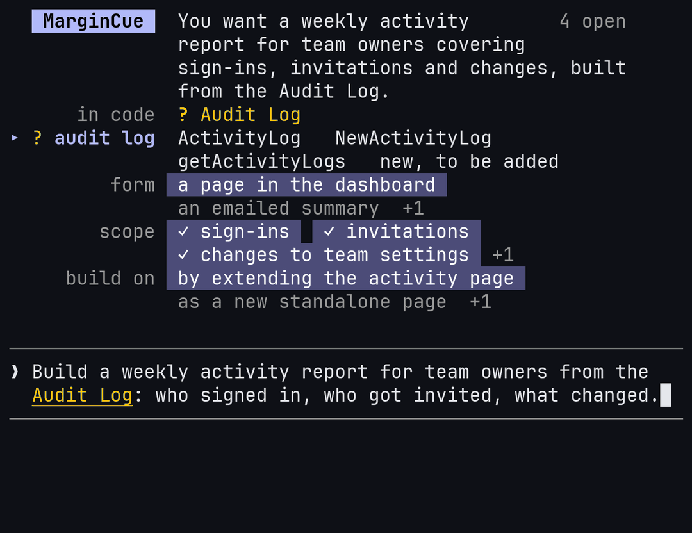

# MarginCue

“Build a site to share our club's photos” leaves out a decision. Who gets to see the photos? MarginCue brings that question into the terminal while you can still answer it.

<a href="https://github.com/fus3r/margincue/releases/download/v0.2.0/margincue-demo.mp4"></a>

## Install

| Host | When questions appear | Setup |
| --- | --- | --- |
| Claude Code | While an eligible draft is still in the composer | [Claude Code ZIP and instructions](mods/claude-code/README.md) |
| Codex CLI | After Enter, at the start of an eligible turn | [Codex package and instructions](mods/codex/README.md) |

Both downloads are on the [v0.2.0 release page](https://github.com/fus3r/margincue/releases/tag/v0.2.0).

### Claude Code

Download `margincue-claude-code.zip` and start Claude Code from a project.

```sh
claude --plugin-dir "$HOME/Downloads/margincue-claude-code.zip"
```

Type the photo-site prompt above and pause. Open **Answer** when it appears, pick a number, and press Esc to return to the draft. Enter sends your confirmed choices with the prompt. Eligible drafts go to Haiku through your signed-in Claude session. `/margincue sheet off` turns the automatic questions off.

### Codex CLI

Download `margincue-codex-macos-arm64.tar.gz` for Apple silicon. Extract it and run this from the extracted `margincue-codex-macos-arm64` directory.

```sh
./mods/codex/margincue install
```

Open a new Codex session and review and trust the two MarginCue hooks. Send the photo-site prompt to try it. The hook asks the acting model to get your choices before starting work. The questions can appear in a picker, an MCP form, or the reply, depending on your settings. The [Codex guide](mods/codex/README.md) covers building from source, the optional picker, and removal.

## Tests

```sh
node --test spec/*.unit.ts
node spec/run-traces.ts
claude plugin test mods/claude-code
cargo test --locked --manifest-path crates/margincue-codex/Cargo.toml
```

The Claude Code mod carries the [MIT license](mods/claude-code/LICENSE). The Codex download includes its dependency license notices.

Inspired by [Bruce Liu's Feedforward demo](https://x.com/liu_xingyu/status/2121015724374397183).
